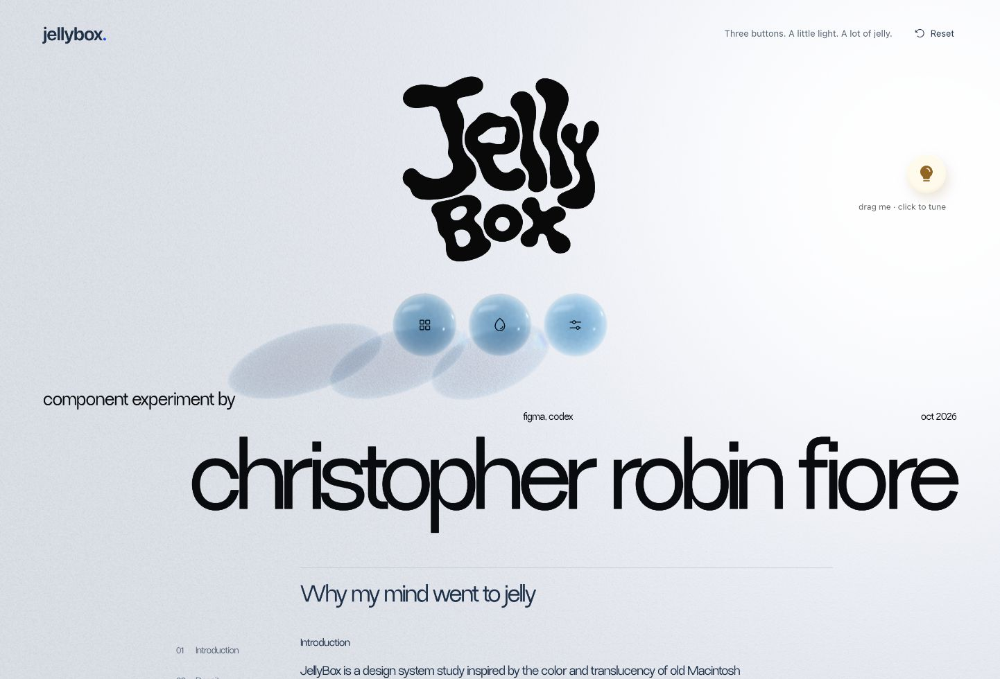

# JellyBox

Three buttons. A little light. A lot of jelly.

A design-system study by [Christopher Robin Fiore](https://christopherfiore.net/), using density, connected movement, color and light to explain an interface. The working prototype is three jelly buttons that gather into shared workspaces. The reusable React foundation is included for experimentation; this is a research preview, not a finished production UI kit.

**[Try the live study](https://globalanomalyindex.github.io/jellybox/)** · [Design story](https://globalanomalyindex.github.io/jellybox/#story-abstract) · [Download v0.5.0](https://github.com/globalanomalyindex/jellybox/releases/tag/v0.5.0)



## Run it

Use Node 24 LTS (the version in `.nvmrc`) and npm.

```sh
git clone https://github.com/globalanomalyindex/jellybox.git
cd jellybox
npm ci
npm run dev
```

Vite prints the local URL. `npm run check` builds and checks the React foundation, the website and the optional static adapter. `npm run preview` serves the production website after a build.

Public clones intentionally use a system-font fallback. The author's live site uses a separately licensed Dessign Maison font supplied privately at deployment; no font license, account or secret is needed to run the project. See [assets and font setup](docs/ASSETS.md).

## Play

- **Explore:** motion presets, size, spacing, Reset experiment, and one browser-local saved look. Save is explicit; ordinary tuning and Reset do not overwrite it.
- **Color:** preview a palette before committing, or choose individual pigments.
- **Material:** translucency, light, thickness, lift and prism. Shape & optics gathers out of the parent window as a denser folder.
- **Light:** drag the bulb, or focus it and use arrow keys (Shift moves farther). Enter opens its controls.
- **Close / Escape:** return a workspace to its button. Text and native targets remain anchored while the material reshapes.

Defaults are Wobbly, 131% size, spacing 17, Glass blue, translucency 6% and surface light 25%. Pause continuous motion or use the operating system's reduced-motion preference. Sliders support native keyboard input and draggable value bubbles; Shift gives fine adjustment and Escape cancels a scrub.

## Reuse the React foundation

The repository contains `@jellybox/react`: seventeen core controls, scoped CSS, semantic tones and shared motion/color helpers. Its optional renderer uses Three.js. Core controls can render without WebGL or Three.

```sh
npm run pack:library
# In another React project:
npm install /path/to/jellybox/release/jellybox-react-0.5.0.tgz
```

Release archives are also attached to [GitHub Releases](https://github.com/globalanomalyindex/jellybox/releases). This release is not published on npm. Import `@jellybox/react/styles.css` once; see the [package guide](packages/react/README.md) and [component API](docs/COMPONENTS.md).

## Find your way around

| Location | Purpose |
| --- | --- |
| `src/` | The three-button study, lighting controls, design story and state composition |
| `packages/react/src/` | Reusable native React controls, CSS, semantic colors and motion |
| `packages/react/src/renderer/` | Optional optical geometry, density fields, material, light and shared transitions |
| `packages/react/test/`, `tests/` | Component/model behavior and the optional static adapter |
| `public/brand/` | Editable SVG identity, supplied raster source and provenance |
| `docs/` | Architecture, design, API, asset licensing, release and verification guides |

Start with [architecture](docs/ARCHITECTURE.md), [material](MATERIAL.md), [motion](MOTION.md), [design](docs/DESIGN.md) and [contributing](CONTRIBUTING.md). [Release operations](docs/RELEASING.md) describe Pages deployment and private font configuration.

## What this demonstrates

Jelly can gather density into a boundary while keeping a reading area thin. A button can remain the owner of a space as it becomes a tab, an inner group can gather out of the same material, and color can distinguish a preview from a committed state. These are implemented interactions and design hypotheses; they are not demonstrated usability improvements.

The optics use authored real-time geometry, raster transmission, analytic receiver filtering and bounded sampled caustics. Spectral.js supplies pigment-inspired color paths, not transparent-jelly light transport. Native text remains above the canvas; the bottom scroll cue coordinates a rendered strip with browser backdrop blur. Read [limits and verification](docs/VERIFICATION.md) before using the renderer or making accessibility/performance claims.

## License

MIT for the code and documentation. [Third-party notices](THIRD_PARTY_NOTICES.md) retain Spectral.js attribution and explain the separate site font. The JellyBox name/logo identify this study; the logo is excluded from the component archive. No commercial font is included in source or package releases.
