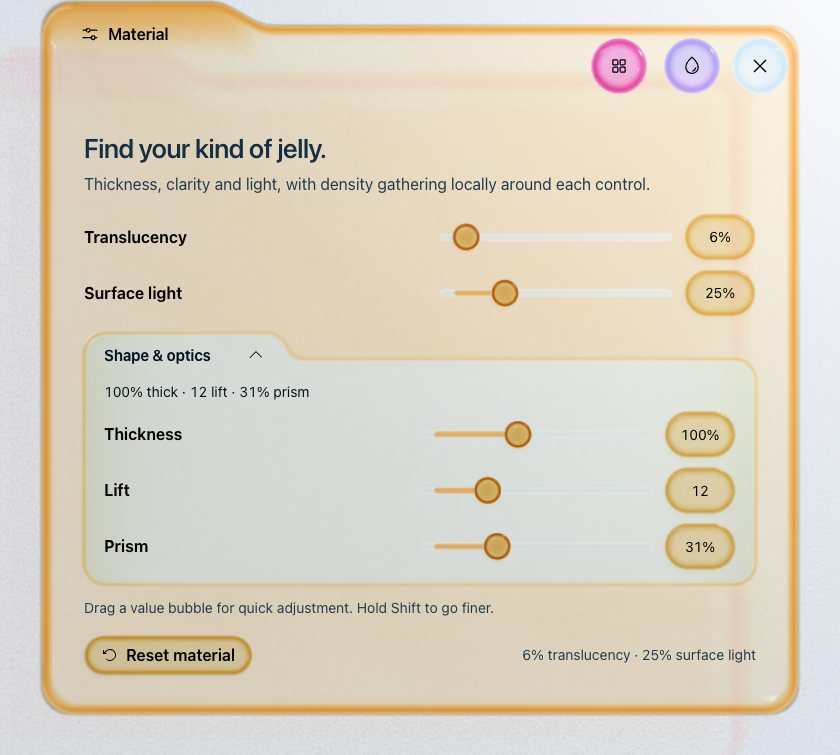

# JellyBox

[Live demo](https://globalanomalyindex.github.io/jellybox/) · [Case study](https://christopherfiore.net/product-designs/jellybox/) · [Releases](https://github.com/globalanomalyindex/jellybox/releases)

I built JellyBox to explore how a fluid, light-reactive interface can keep clear structure. I love the color and translucency of old Macintosh interfaces and Frutiger Aero: how fun, vibrant and alive they feel. I wanted to carry that energy into a system for how an interface behaves.

Jelly gives me a way to do that through density. A concentrated edge can establish a boundary; a thinner area can leave room for reading. A button can stretch into its own workspace, gather into a tab, then return to the same button. Color, motion and light belong to that shared material, while text and controls stay steady.


## The experiment

Three tools are my current proving ground for the wider system:

- **Explore** changes movement, button size and spacing, with an explicit browser-local saved look.
- **Color** previews palettes before committing them. The preview jelly breathes while a choice is pending; the selected check stays on the accepted palette. Individual pigments can also be edited.
- **Material** adjusts translucency, surface light, thickness, lift and prism. Shape & optics gathers into a denser inner folder.

The bulb works like a lamp on a desk. Drag it into place or open its lighting options; highlights, transmitted color and surface casts follow it. The design story below the tools includes automatic examples of density, motion, loading states, color relationships and ambient lighting.

The website uses the same React foundation included here. Sliders, choices and inner controls inherit their workspace's pigment; save, warning and destructive actions keep their semantic colors. A closing workspace carries its color back into its button.



I’ve implemented these interactions, but I haven’t validated their usability benefits yet. This is a working design-system study and experimental React foundation.

## Run locally

Use Node 24 LTS and npm:

```sh
git clone https://github.com/globalanomalyindex/jellybox.git
cd jellybox
npm ci
npm run dev
```

`npm run build` creates the static site in `dist/`. `npm run preview` serves that build. No account, backend or private asset is required. My live site uses separately licensed Dessign Maison; public clones use the system-font fallback. See [assets and licensing](docs/ASSETS.md).

The starting settings are Wobbly, 131% size, spacing 17, Glass blue, 6% translucency and 25% surface light. The desktop workspace and controls grow together; narrow screens keep a bounded layout. Continuous motion can be paused, and reduced-motion preferences are respected. Keyboard controls, visible focus, labels and selected checks remain independent of the material effects.

## Use the React foundation

`@jellybox/react` is available as a GitHub release archive; I haven’t published it to npm.

```sh
npm install https://github.com/globalanomalyindex/jellybox/releases/download/v0.5.18/jellybox-react-0.5.18.tgz
```

Import `@jellybox/react/styles.css` once. Core controls work without Three.js; the optical renderer is optional. To build the archive locally, run `npm run pack:library`.

The [package guide](packages/react/README.md) covers installation and composition. The [API reference](docs/COMPONENTS.md) covers native behavior, props, shared pigment, motion and renderer limits.

## How it works

I use changing density to communicate hierarchy and grouping, motion to explain ownership and change, and color to distinguish preview, selection and outcomes. Spectral.js supplies cached, pigment-inspired color paths. One optional Three.js scene handles the material, lighting and surface casts.

These optics are authored real-time approximations. Spectral.js models pigment mixing rather than light passing through transparent jelly; the renderer is not a validated fluid simulation. Native semantics and sampled contrast checks also need broader device and accessibility evaluation.

- [Design principles and vocabulary](docs/DESIGN.md)
- [Material and density](MATERIAL.md) · [Motion](MOTION.md)
- [Architecture](docs/ARCHITECTURE.md) · [Testing and limits](docs/TESTING.md)
- [Contributing](CONTRIBUTING.md) · [Roadmap](ROADMAP.md)
- [Changelog](CHANGELOG.md) · [Release and deployment](docs/RELEASING.md)

## License

I release the code and documentation under [MIT](LICENSE). [Third-party notices](THIRD_PARTY_NOTICES.md) retain dependency attribution. No commercial font is included in source or component archives. The logo identifies this study and is excluded from the reusable package.

— [christopher robin fiore](https://christopherfiore.net/) / [globalanomalyindex](https://github.com/globalanomalyindex)
